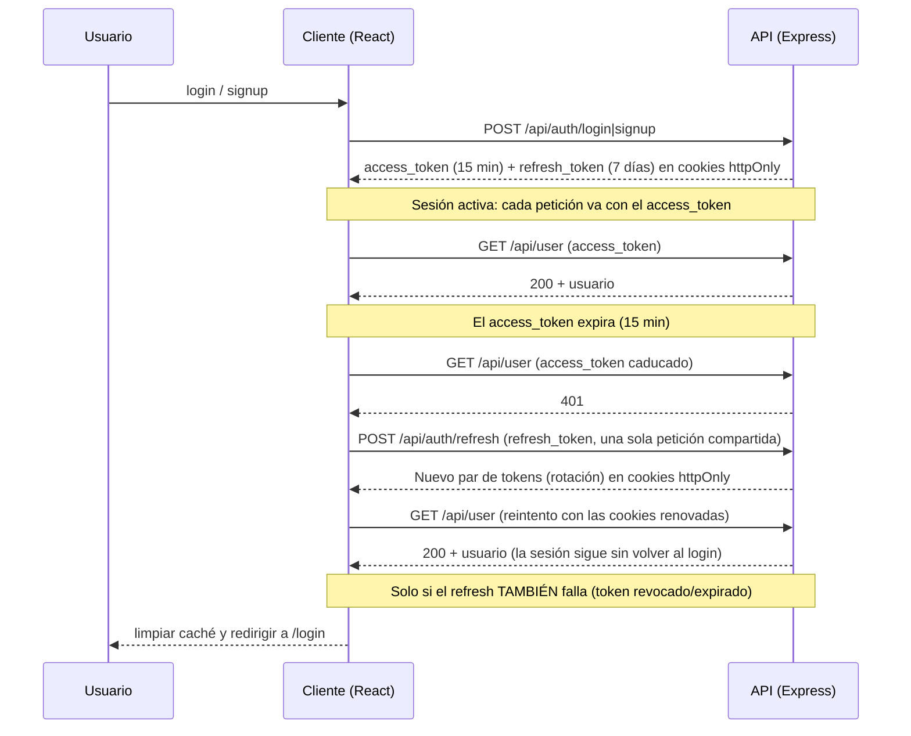
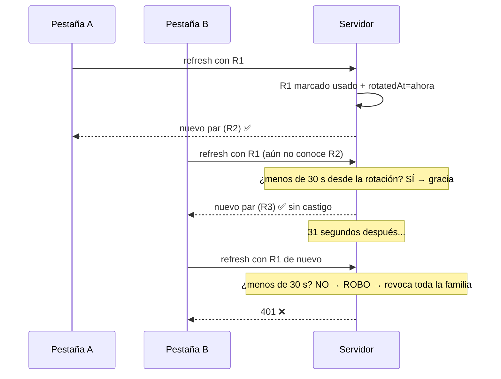

# MERN TEMPLATE [React and Express Configuration] 👋

[](https://github.com/node-projects-znareak/mern-template)
[](https://twitter.com/libardo_r12)

> Welcome to MERN TEMPLATE for your own projects :)

Monorepo with an Express 5 + Mongoose + TypeScript backend and a React 19 + Vite + TanStack Query frontend. Authentication is handled with **httpOnly cookies + rotating refresh tokens** (no localStorage).

## Requirements

- Node.js >= 22.12 (developed with v26.x)
- pnpm 10.x (fixed via `packageManager` in both `package.json`)
- MongoDB running locally (default: `mongodb://localhost:27017/mern_template_dev`)

## Install Client and Server Modules

### Windows

```sh
install.bat
```

### Other Operative Systems

```sh
pnpm install        # at the root, or inside client/ and server/
```

## Environment variables

Copy `server/.env.example` to `server/.env` and adjust the values.

| Variable                                               | Description                                                                                            |
| ------------------------------------------------------ | ------------------------------------------------------------------------------------------------------ |
| `PORT`                                                 | API port (default `5000`). If busy, the server auto-falls back to the next port.                       |
| `HOST`                                                 | Address to bind (default `localhost`).                                                                 |
| `ENVIROMENT`                                           | `development` \| `production` \| `test`. Controls `secure` cookies, logs, Swagger and Mongo pool size. |
| `JWT_SECRET_TOKEN`                                     | HS256 secret (min 32 chars).                                                                           |
| `JWT_SALT_TOKEN`                                       | bcrypt cost factor (OWASP recommends >= 10).                                                           |
| `DUMMY_PASSWORD`                                       | Dummy password for timing-safe login (anti user-enumeration).                                          |
| `CORS_ALLOWED_DOMAINS`                                 | Comma-separated allowed origins.                                                                       |
| `TRUST_PROXY`                                          | `"true"` only behind nginx / a reverse proxy.                                                          |
| `MONGO_DB_URI_DEVELOPMENT` / `MONGO_DB_URI_PRODUCTION` | Mongo URIs per environment.                                                                            |
| `HTTPS_CERT_PATH` / `HTTPS_KEY_PATH`                   | Optional. If both are set, the server listens with HTTPS (used by the production simulation).          |

Optional client env (`client/.env`): `VITE_API_URL` (default `http://localhost:5000/api`).

## Start both servers (Backend + Frontend)

### Windows

```sh
start.bat
```

Opens two consoles: `pnpm dev` (server) and `pnpm dev` (client at `http://localhost:4000`).

### Other Operative Systems

```sh
# Backend
cd ./server
pnpm dev           # tsx + nodemon (watch)
pnpm start         # tsx, no watch

# Client
cd ./client
pnpm dev           # Vite dev server on :4000
```

## Server scripts

| Command                         | Description                                                    |
| ------------------------------- | -------------------------------------------------------------- |
| `pnpm dev`                      | Dev server with nodemon watch (loads `.env`).                  |
| `pnpm start`                    | Dev server without watch (loads `.env`).                       |
| `pnpm start:prod`               | Production-like server (loads `.env.production.local`, HTTPS). |
| `pnpm dev:prod`                 | Production-like server with nodemon watch.                     |
| `pnpm build` / `pnpm typecheck` | Compile / type-check.                                          |
| `pnpm lint` / `pnpm test`       | ESLint / Jest tests.                                           |

## Authentication and sessions

### Cookies

Tokens live in **httpOnly cookies** — JavaScript can't read them, which mitigates XSS token theft.

| Cookie          | httpOnly | maxAge | Path        | Purpose                                                                         |
| --------------- | -------- | ------ | ----------- | ------------------------------------------------------------------------------- |
| `access_token`  | ✅       | 15 min | `/`         | JWT used to authorize requests. TTL configurable via `ACCESS_TOKEN_EXPIRES_IN`. |
| `refresh_token` | ✅       | 7 days | `/api/auth` | Rotated on every refresh; reuse detection revokes the token family.             |

- `sameSite: "lax"` on all of them; `secure` is enabled automatically when `ENVIROMENT=production`.
- Passwords: bcrypt async (cost 10); `passwordChangedAt` invalidates tokens issued before a password change.

### Endpoints

| Method | Path                    | Description                                            |
| ------ | ----------------------- | ------------------------------------------------------ |
| POST   | `/api/auth/signup`      | Register and start a session (rate-limited).           |
| POST   | `/api/auth/login`       | Log in and start a session (rate-limited).             |
| POST   | `/api/auth/refresh`     | Rotate the refresh token and issue a new access token. |
| POST   | `/api/auth/logout`      | Revoke the refresh token and clear cookies.            |
| GET    | `/api/auth/check-email` | Check email availability.                              |
| GET    | `/api/user`             | Current session (protected).                           |

**Rate limit**: auth endpoints allow **30 requests / 15 min per IP** (in-memory, resets on server restart). A global limit of 500 requests / 2 min applies to the API.

### How the session stays alive (token lifecycle)

Both tokens are issued **at the same time** on signup and login (`TokenService.issueTokenPair()` + `setAuthCookies()`):



Key points:

- **Renovación transparente**: cuando el `access_token` expira, el interceptor 401 del cliente llama a `/api/auth/refresh` automáticamente, el servidor rota el par de tokens, re-emite las cookies y **reintenta la petición original**. El usuario nunca vuelve al login mientras el `refresh_token` siga válido (7 días).
- **Sin tormentas de refresh**: varios 401 simultáneos comparten una única petición de refresh (`refreshPromise` en `client/src/utils/http.ts`).
- **Detección de reuso**: si un `refresh_token` ya rotado se vuelve a usar, se revoca toda la familia de tokens del usuario (mitigación de robo de refresh tokens). Hay una **ventana de gracia de 30 s** para rotaciones concurrentes (varias pestañas refrescando a la vez) que no se tratan como reuso; además, el cliente serializa el refresh entre pestañas con la Web Locks API.
- **Solo se va a `/login`** cuando el refresh también devuelve 401 (sesión irrecuperable); en ese momento se limpia la caché de TanStack Query y se redirige.

### Grace window for concurrent refreshes

Refresh rotation is also a **theft detector**: presenting a refresh token that was already rotated is treated as reuse (someone else has it) and revokes the whole token family. But that logic caused a real-world bug with **two open tabs**:

```
Tab A: [401] ──► POST /refresh with R1 ──► server rotates: R1 marked used, issues R2 ✅
Tab B: [401] ──► POST /refresh with R1 ──► "R1 already used!" → REUSE → revoke family ❌
                                           → 401 + cookies cleared (session disappears)
```

Tab B was not malicious: it simply hadn't received the new cookie (R2) yet when it sent its request with R1. The server couldn't tell "two tabs refreshing at once" apart from "stolen token".

The fix is a **grace window** (`REFRESH_ROTATION_GRACE_MS = 30 s` in `server/src/services/token.ts`): right after a rotation, presenting the old token again within 30 seconds is treated as a legitimate concurrent rotation (a new pair is issued, no punishment). After the window, reuse is theft again and the family is revoked:



As defense in depth, the client also serializes refreshes across tabs with the **Web Locks API** (`mern-template:session-refresh` in `client/src/utils/http.ts`), so tabs rarely refresh simultaneously — the server-side grace remains as a safety net for browsers without Web Locks.

### Frontend session flow

- Axios instance with `withCredentials` + a **401 interceptor** that:
  1. Refreshes the session with a single shared request (concurrent 401s share one refresh).
  2. Retries the original request once.
  3. Clears the query cache and navigates to `/login` if the refresh fails.
- Session cached in TanStack Query (`["userSession"]`). `getSession` only calls `GET /api/user` when the `session_present` flag cookie exists — **no `/user` or `/refresh` requests after logout**. The server always sets/clears the flag together with the tokens.
- Cross-tab sync via `BroadcastChannel`: login/logout in one tab propagate to the rest.
- Route guards:
  - `PrivateRoute` → blocks `/profile` without session (redirects to `/`).
  - `RedirectRoute` → keeps authenticated users out of `/login` (→ `/`) and `/register` (→ `/profile`). The target is configurable with `redirectTo` in `src/config/routes.ts`.

## Simulating production locally (HTTPS)

1. Install [mkcert](https://github.com/FiloSottile/mkcert) (Windows):

   ```sh
   winget install FiloSottile.mkcert
   ```

2. Create the local CA and the certificates:

   ```sh
   cd server
   mkcert -install
   mkdir certs
   cd certs
   mkcert -key-file key.pem -cert-file cert.pem localhost 127.0.0.1 ::1
   ```

   `mkcert -install` adds the CA to the OS trust store, so browsers accept the certs without warnings. (The Java `keytool` warning can be ignored — it doesn't affect browsers.)

3. Run the API as "production":

   ```sh
   cd server
   pnpm dev:prod      # nodemon watch, or: pnpm start:prod
   ```

   This loads `.env.production.local`: `ENVIROMENT=production`, HTTPS on port `5002`, local Mongo and CORS for `https://localhost:4173`.

4. Build and serve the client:

   ```sh
   # PowerShell
   cd client
   $env:VITE_API_URL='https://localhost:5002/api'
   $env:HTTPS_CERT_PATH="$PWD\..\server\certs\cert.pem"
   $env:HTTPS_KEY_PATH="$PWD\..\server\certs\key.pem"
   pnpm build
   pnpm exec vite preview --host --port 4173

   # Linux / macOS
   cd client
   export VITE_API_URL=https://localhost:5002/api
   export HTTPS_CERT_PATH=../server/certs/cert.pem
   export HTTPS_KEY_PATH=../server/certs/key.pem
   pnpm build
   pnpm exec vite preview --host --port 4173
   ```

5. Open <https://localhost:4173>.

Notes:

- The auth rate limiter is in-memory: it resets when the process restarts.
- `server/certs/` and `server/.env.production.local` are git-ignored.

## Run tests and build

```sh
# Server
cd ./server
pnpm test
pnpm lint
pnpm typecheck

# Client
cd ./client
pnpm lint
pnpm build
```

## Docker

The API ships with a multi-stage `Dockerfile` and a `docker-compose.yml` (api + mongo + nginx with TLS termination and health checks) inside `server/`. See `server/dockerfile`, `server/docker-compose.yml` and `server/nginx.conf`.

## Deploy to Railway (frontend + API on one service)

The root `Dockerfile` packs the client and the server behind nginx **on a single domain**, so the httpOnly cookies (and the `session_present` flag) work first-party. This is required because `up.railway.app` is a public suffix: two separate Railway services (`*.up.railway.app`) are cross-site and cookies won't flow between them.

1. Create a new Railway service from the repository root (it picks up the root `railway.json`: DOCKERFILE builder, `Dockerfile`, healthcheck `/health`).
2. Set the service variables:

   ```
   ENVIROMENT=production
   JWT_SECRET_TOKEN=<secret, at least 32 chars>
   JWT_SALT_TOKEN=10
   DUMMY_PASSWORD=dummy-password-for-timing
   TRUST_PROXY=true
   MONGO_DB_URI_PRODUCTION=<your Atlas URI>
   MONGO_DB_URI_DEVELOPMENT=<same URI, required by the schema>
   CORS_ALLOWED_DOMAINS="https://<your-domain>.up.railway.app"
   ```

3. In Networking → Generate domain. Open `https://<your-domain>.up.railway.app`.

Inside the container: nginx listens on Railway's injected `PORT` and serves the SPA (`/`) while proxying `/api` and `/health` to Express on the internal port `5000`. `VITE_API_URL` defaults to `/api` (same origin) at build time, so no extra frontend variables are needed.

## Author

👤 **Libardo Rengifo**

- Website: https://portfolio-znareak.vercel.app/
- Twitter: [@libardo_r12](https://twitter.com/libardo_r12)
- Github: [@znareak](https://github.com/znareak)

## Show your support

Give a ⭐️ if this project helped you!
