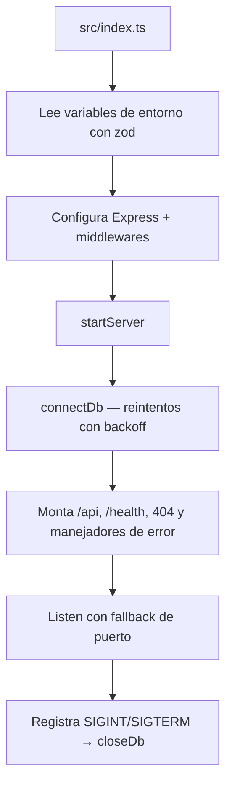
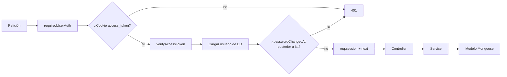
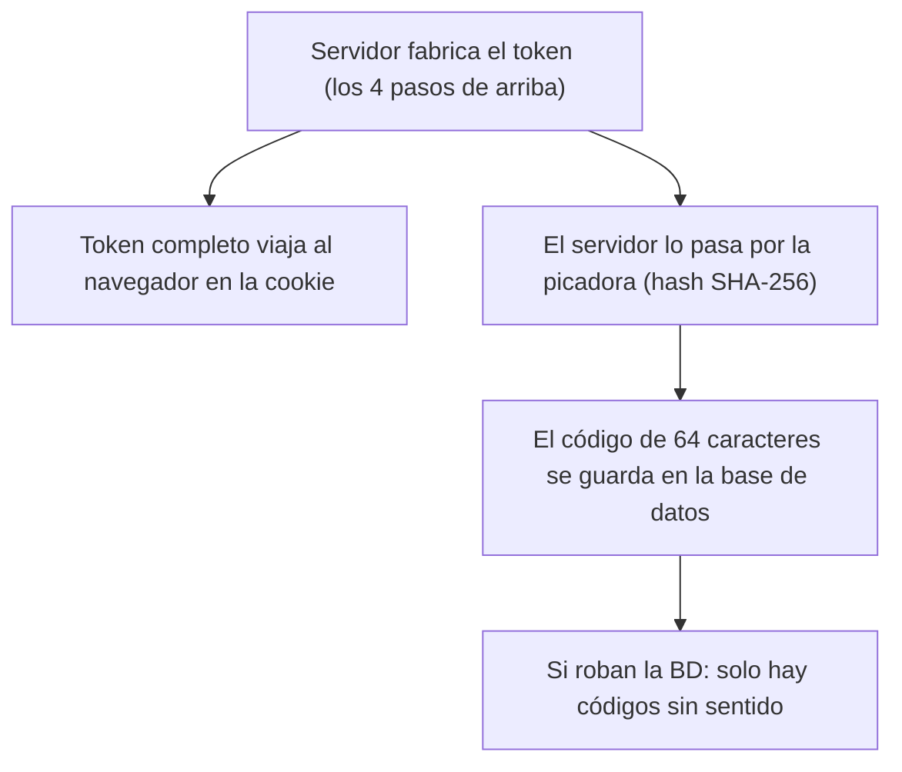
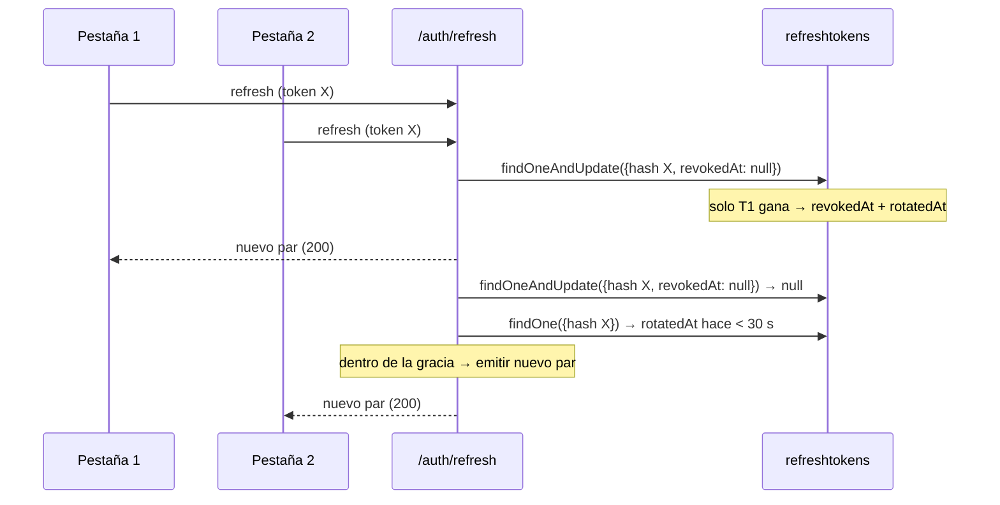
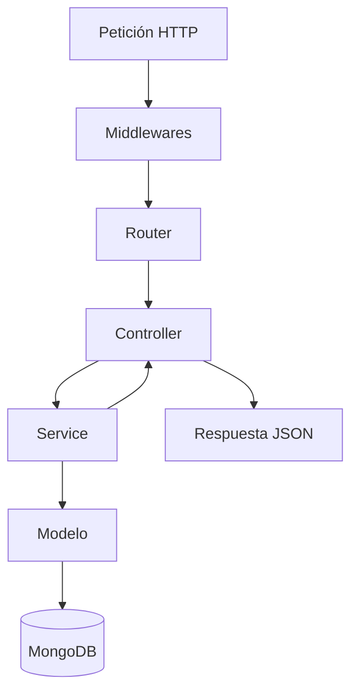

# Backend — Cómo funciona, arquitectura y modelo de seguridad

Documentación interna del backend (`server/`) del proyecto MERN Template.

---

## 1. Cómo funciona el backend

### Arranque



1. **`src/index.ts`** es el punto de entrada. Carga las variables de entorno (validadas con zod en `helpers/env.ts`), construye la app de Express y arranca el servidor.
2. **`config/server.ts`** (`startServer`) se conecta a MongoDB, monta las rutas, define `/health`, el 404 y los manejadores de error, y escucha en el puerto (probando el siguiente si está ocupado).
3. **`config/connection.ts`** gestiona la conexión a Mongo: pool por entorno, reintentos secuenciales con backoff y cierre ordenado.

### Middlewares (en orden, `index.ts`)

1. `REQUEST_ID_MIDDLEWARE` — asigna/acepta un `X-Request-Id` por petición.
2. `COMPRESSION_MIDDLEWARE` — comprime respuestas.
3. `PARSING_MIDDLEWARES` — `cookie-parser`, `express.json` (100 kb), `express.urlencoded` (100 kb).
4. `SECURITY_MIDDLEWARES` — `helmet`, CSP (omite `/api-docs`), `hpp`, rate limit global, guard CSRF, guard anti-NoSQL/prototype pollution.
5. `CORS_MIDDLEWARE` — allowlist de orígenes.

### Flujo de una petición autenticada



El middleware `requiredUserAuth` (`middlewares/index.ts`) lee el access token **solo** de la cookie httpOnly, lo verifica (HS256, `iss`/`aud`/`type`), carga al usuario de la BD y comprueba que la sesión no se haya invalidado por un cambio de contraseña. Si la BD falla, el error va al manejador global (500) y no se disfraza de 401.

### Autenticación (flujo completo)

1. **Login/Signup** → `TokenService.issueTokenPair` → devuelve access token (15 min) + refresh token (7 días).
2. Las cookies `access_token` y `refresh_token` se emiten httpOnly; se añade la bandera `session_present` (no httpOnly) para que el frontend sepa si hay sesión sin llamar a la API.
3. **Acceso** → el access token viaja en la cookie y se verifica en cada petición protegida.
4. **Renovación** → cuando el access token caduca, el cliente llama a `POST /auth/refresh`, que **rota** el refresh token (ver sección 2).
5. **Logout** → revoca el refresh token y limpia las cookies.

### Cómo se crean los tokens, paso a paso (sin tecnicismos)

**La idea en una frase:** cuando inicias sesión, el servidor fabrica dos "tarjetas" — una de acceso que caduca a los 15 minutos (access token) y una de repuesto que dura 7 días y sirve solo para pedir otra tarjeta de acceso sin escribir tu contraseña otra vez (refresh token). Las dos se fabrican de la misma manera. Vamos a fabricar una juntos, despacio.

**Paso 1 — El servidor escribe lo que dice la tarjeta.**

Junta dos textos:

- El primero dice **cómo está protegida** la tarjeta: `{"alg":"HS256","typ":"JWT"}`. Traducido: "se va a firmar con un método llamado HS256".
- El segundo dice **qué contiene**. Por ejemplo, una tarjeta de repuesto diría:

```json
{
  "type": "refresh",
  "sub": "665f9c123456",
  "exp": 1769604800,
  "aud": "mern-template-web",
  "iss": "mern-template-api"
}
```

Es decir: "soy de tipo repuesto, pertenezco al usuario `665f9c...`, caduco en tal fecha, me emitió `mern-template-api` para la app `mern-template-web`".

**Paso 2 — Escribe esos textos en un formato cómodo para viajar.**

Ese formato se llama base64url y lo único que hace es convertir el texto a letras y números "seguros" (sin espacios ni símbolos raros), para que el token pueda viajar dentro de una cookie y en cada petición sin romperse.

Un detalle importante: **esto no esconde nada**. Cualquiera puede volver a convertir el texto y leerlo. Es como una nota escrita en clave pero con el diccionario disponible para todos.

**Paso 3 — El servidor le pone su sello (la firma).**

Coge los dos textos ya convertidos, los junta con un punto y los mete en una función junto con su **palabra secreta** (guardada en `JWT_SECRET_TOKEN`, que solo conoce el servidor). La función devuelve un texto corto: **la firma**.

La gracia de la firma es esta: cualquiera puede _leer_ la tarjeta, pero solo quien conoce la palabra secreta puede _fabricar_ la firma correcta. Si alguien cambia una sola letra del contenido, la firma deja de encajar y el servidor se da cuenta al momento.

**Paso 4 — El resultado final es el token.**

```text
texto1 . texto2 . firma
```

Esa cadena completa **es** el token. Se envía al navegador dentro de una cookie httpOnly (una cookie que el JavaScript de la página no puede leer; solo viaja de vuelta al servidor con cada petición).

---

**¿Y el hash que se guarda en la base de datos? Es otra cosa, no te confundas.**

Imagina una "picadora" de una sola dirección: metes el token completo y sale un código fijo de 64 letras y números. Se llama hash SHA-256 y tiene dos propiedades:

- El **mismo token** produce **siempre el mismo código**.
- Del código **es imposible volver atrás** y reconstruir el token. Jamás.

Así que en la base de datos se guarda **ese código**, nunca el token:

1. **Por seguridad:** si alguien roba la base de datos, solo consigue códigos sin sentido. Con un código no puede entrar a ninguna cuenta, porque para entrar hace falta el token de verdad (con su firma).
2. **Porque al servidor le basta:** cuando le llega un refresh token en una petición, lo pasa por la misma "picadora" y busca el código resultante en la base de datos. Si existe y no está tachado como revocado, todo correcto. No necesita guardar el token original para comprobar nada.



El access token, en cambio, **no se guarda en ningún sitio**: como caduca en 15 minutos, el servidor no necesita llevar su registro — lo comprueba sobre la marcha cada vez que llega, solo mirando si su firma sigue siendo correcta.

**Resumen con pocas palabras:**

| Qué es                              | Dónde vive                    | Para qué sirve                                                          | Si se roba, ¿qué pasa?                                                                                     |
| ----------------------------------- | ----------------------------- | ----------------------------------------------------------------------- | ---------------------------------------------------------------------------------------------------------- |
| **Token** (la tarjeta firmada)      | Cookie httpOnly del navegador | Para identificarse en cada petición                                     | El ladrón puede usarlo durante su tiempo de vida (por eso el access dura solo 15 min y el refresh se rota) |
| **Hash** (el código de la picadora) | Base de datos                 | Para que el servidor compruebe si un refresh está revocado o fue rotado | Nada: con el código no se puede entrar a ninguna cuenta                                                    |

---

## 2. La ventana de gracia (grace window)

### Qué es

Un intervalo corto de tiempo tras una rotación de refresh token en el que volver a presentar **el mismo token ya rotado** no se considera robo, sino una **rotación concurrente legítima**.

En el código: `REFRESH_ROTATION_GRACE_MS = 30 * 1000` (30 segundos) en `services/token.ts`.

### Para qué se usa

El refresh token se rota de forma **atómica**: solo UNA petición puede marcar el token como revocado (`revokedAt`) y rotado (`rotatedAt`).

El problema real: con varias pestañas abiertas, dos de ellas pueden intentar refrescar **al mismo tiempo** con la misma cookie. Sin la gracia, la pestaña que pierde la carrera parecería estar reutilizando un token ya consumido, y el sistema (siguiendo la detección de reuso) **revocaría toda la familia de sesiones** del usuario, cerrándole la sesión de golpe.

La ventana de gracia evita ese falso positivo: durante 30 segundos, un reuso se interpreta como "otra pestaña ganó la carrera" y simplemente se emite un nuevo par.

### Cómo se usa en este proyecto

`rotateRefreshToken(presentedToken)` en `services/token.ts`:

1. **Verifica** la firma del token.
2. **Intenta la rotación atómica**:

   ```ts
   const rotated = await RefreshTokenModel.findOneAndUpdate(
     { tokenHash, revokedAt: null },
     { revokedAt: new Date(), rotatedAt: new Date() },
   );
   ```

   - Si `rotated` existe → esta petición **ganó**: emite un nuevo par.

3. **Si ya estaba revocado** (`rotated === null`), lee el documento y evalúa:

   ```ts
   const wasRotatedRecently = Date.now() - stored.rotatedAt.getTime() <= REFRESH_ROTATION_GRACE_MS;
   ```

   - `true` → rotación concurrente dentro de la gracia → emite un nuevo par.
   - `false` → **reuso real (posible robo)** → revoca toda la familia del usuario y devuelve `null`.



**Complemento en el cliente:** el frontend serializa el refresh entre pestañas con **Web Locks** (`mern-template:session-refresh` en `utils/http.ts`), reduciendo ya de por sí la probabilidad de dos refreshes simultáneos. La gracia en el servidor cubre el caso residual en el que aún así coincidan.

**Si el reuso ocurre fuera de la gracia** (token robado reutilizado más de 30 s después), se revoca la familia entera y la sesión queda invalidada — el cliente recibe 401 y hace logout.

---

## 3. Arquitectura

### Estructura por capas

```
src/
├── index.ts            # Punto de entrada (Express + swagger dev)
├── config/             # Arranque, conexión, variables (server, connection, variables)
├── routes/             # Definición de rutas y middlewares por recurso (auth, user)
├── controllers/        # Orquestan request/response (auth, user)
├── services/           # Lógica de negocio (token, user)
├── models/             # Esquemas Mongoose (user, refreshToken)
├── helpers/            # Utilidades (jwt, password, cookies, logger, validate...)
├── middlewares/        # auth, errores, utils (seguridad)
├── schemas/            # Validación yup por ruta (auth)
└── types/              # Tipos compartidos (brand, api, auth, env...)
```

### Principios aplicados

- **Separación por responsabilidad**: `routes` → `controllers` → `services` → `models`. Los controllers no tocan la BD directamente; lo hacen los servicios.
- **Alias de importación**: `@config`, `@helpers`, `@services`, etc. (resueltos por `tsconfig` en dev y `module-alias` en el build).
- **Barrels**: `helpers/index.ts` re-exporta las utilidades; cada módulo importa lo justo.
- **TypeScript estricto**: `strict`, `noUncheckedIndexedAccess`, `exactOptionalPropertyTypes`, sin `enum` (se usan `as const`), branded types (`UserId`).
- **Configuración por entorno** validada con **zod** al arrancar: un valor inválido detiene el proceso en lugar de fallar en runtime.
- **Logs estructurados** con **pino**: JSON en producción, pretty en desarrollo, con redacción de secretos y `requestId`.
- **Errores** con **boom**: payload uniforme, sin fuga de stack en producción, siempre JSON.

### Flujo de datos



---

## 4. Modelo de seguridad (equipo de seguridad)

### Visión general

La seguridad se aplica **en profundidad**: cada capa aporta su propia defensa, de modo que el fallo de una no deja el sistema expuesto.

| Capa                  | Controles                                                                                                    |
| --------------------- | ------------------------------------------------------------------------------------------------------------ |
| **Autenticación**     | JWT HS256 fijado, `iss`/`aud`/`type`, access 15 min, refresh 7 días con rotación y detección de reuso        |
| **Sesión**            | Cookies httpOnly + `sameSite=lax` + `secure` en prod; sin localStorage en el cliente                         |
| **Autorización**      | `requiredUserAuth` en toda ruta protegida; operación sobre `req.session.userId` (nunca ID del cliente)       |
| **CSRF**              | `CSRF_ORIGIN_GUARD` (escrituras con `Origin` fuera de allowlist → 403) + `sameSite=lax` + CORS con allowlist |
| **Inyección**         | Validación yup de tipos + guard que elimina `$`, `.`, `__proto__`, `constructor`, `prototype`                |
| **Abuso/brute force** | Rate limit global + por IP en auth + por cuenta en login + bucket separado para refresh/logout               |
| **Cabeceras**         | `helmet`, CSP (API y SPA), `hpp`, `x-powered-by` off                                                         |
| **Secretos**          | Variables de entorno validadas; secreto JWT aleatorio de 48 B; `.env` y `certs/` gitignored; bcrypt coste 12 |
| **Errores**           | Sin stack en prod, siempre JSON, `requestId` para correlación                                                |
| **Logs**              | Pino con redacción de `authorization`, `cookie`, `set-cookie` y contraseñas                                  |
| **Supply chain**      | Lockfile + `--frozen-lockfile` + `pnpm audit` en CI + overrides de dependencias vulnerables                  |
| **Contenedor**        | Docker multi-etapa, solo dependencias de producción, `USER node` (sin root)                                  |

### Controles destacados

1. **Rotación de refresh con detección de reuso** — el pilar de la sesión: un token robado reutilizado revoca toda la familia.
2. **Cambio de contraseña fail-safe** — revoca todas las sesiones _antes_ de actualizar la contraseña, de modo que un token robado no sobrevive al cambio ni siquiera ante un crash entre operaciones.
3. **Anti-enumeración por timing** — en el login se compara siempre contra un hash (real o dummy) para no revelar si el usuario existe.
4. **Registro atómico** — el email duplicado se resuelve con el índice único + E11000 → 409, sin ventana de carrera explotable.
5. **Guard NoSQL + prototype pollution** — se limpian `body`, `query` y `params` antes de llegar a Mongoose.

---

## 5. Resumen rápido

| Pregunta                      | Respuesta                                                                                     |
| ----------------------------- | --------------------------------------------------------------------------------------------- |
| ¿Dónde entra el código?       | `src/index.ts` → `config/server.ts`                                                           |
| ¿Cómo se autentica?           | Cookies httpOnly con JWT (access 15 min + refresh 7 días rotable)                             |
| ¿Qué es la ventana de gracia? | 30 s tras rotar un token en los que un reuso se trata como rotación concurrente, no como robo |
| ¿Por qué existe?              | Para que varias pestañas refrescando a la vez no se cierren la sesión entre sí                |
| ¿Arquitectura?                | Por capas: routes → controllers → services → models, TypeScript estricto, alias               |
| ¿Seguridad?                   | En profundidad: JWT, cookies, CSRF, inyección, rate limit, cabeceras, secretos, supply chain  |
